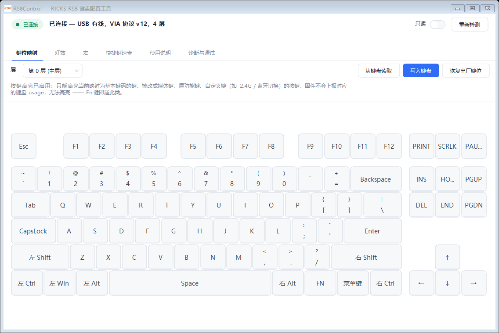
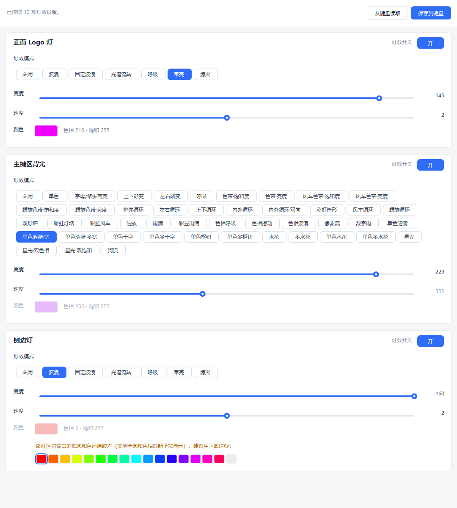
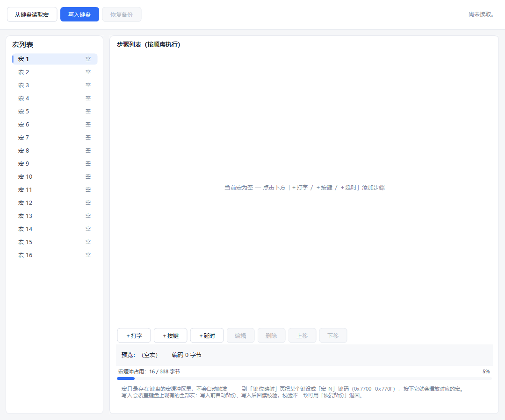
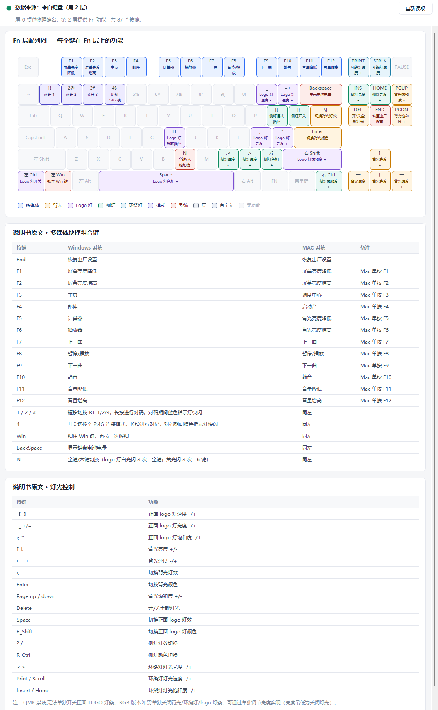
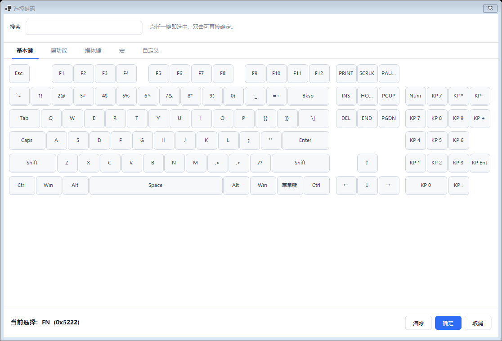
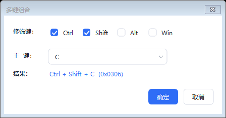
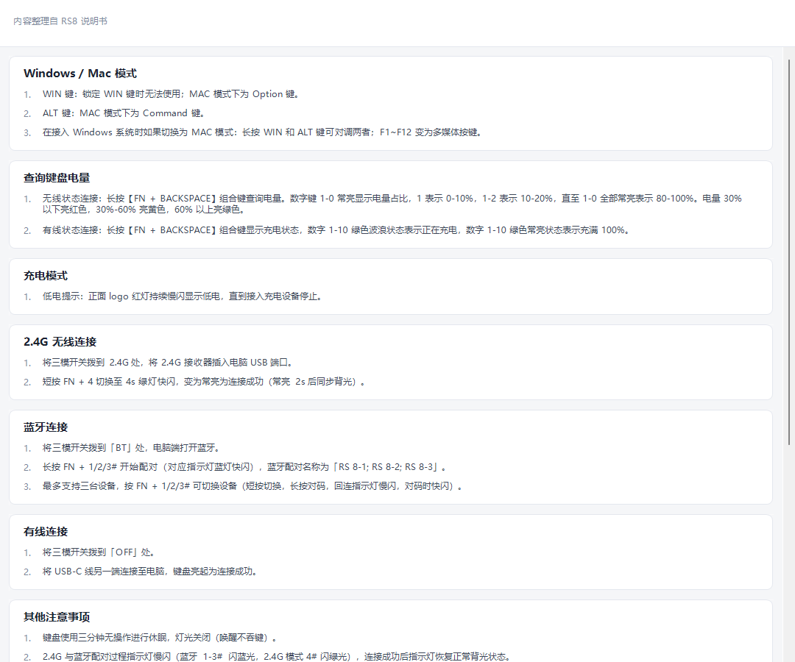

# RS8Control — RICKS RS8 键盘轻量配置工具

轻量级原生 Windows 桌面配置工具，基于键盘出厂固件内置的 **VIA v12 Raw HID 协议**直接读写配置 —— **无需刷固件、无需安装驱动、无需管理员权限、不常驻后台**，以原生 .NET 10 + WinForms 自绘极简扁平浅色界面替代臃肿的官方客户端。



---

## 下载与快速开始

前往 [**Releases 页面**](https://github.com/Xidup/RS8/releases) 下载最新压缩包：

| 发布包 | 说明 | 适用人群 |
|---|---|---|
| `RS8Control-v1.0.0-win-x64-standalone.zip` | **单文件免依赖独立版**（内置 .NET 10 运行时） | 推荐大多数用户，解压后直接双击运行 |
| `RS8Control-v1.0.0-win-x64-net10.zip` | **轻量便携版**（约 300 KB，需本机已安装 .NET 10 Desktop Runtime） | 已安装 .NET 10 的开发机 |

### 使用步骤

1. 使用 **USB 数据线**连接 RICKS RS8 键盘（切到有线模式；2.4G 接收器见[已知边界](#via-v12-协议与已知边界)）。
2. 解压下载的压缩包，确保 `RS8Control.exe` 同目录下保留 `defs/` 文件夹。
3. 双击运行 `RS8Control.exe`：顶部状态胶囊变为绿色 **「已连接」** 并自动读取第 0 层键位后即可改键、调灯、编排宏。

> 如果使用轻量版且系统尚未安装运行时，可安装 Microsoft **.NET 10 Desktop Runtime (win-x64)**。

---

## 核心功能

- **键位映射（4 层完整支持）**：
  - 按官方 `RS8_via.json` 自动渲染 87 键 TKL 配列（修正 ISO/ANSI 偏移，离线状态下仍提供 87 键底图与 4 层预览）。
  - 通过 VIA 批量通道 `0x12 / 0x13` 高速读写整层（192 字节 7 帧传输，实测整层读 ~14–16 ms、批量写 ~15 ms），改过的键位红框标出，支持热插拔自动重连。
  - **常驻按键实时高亮**：基于 Win32 Raw Input 监听物理按键（过滤 `Pause` 组合序列），按下基础键时画布实时绿框高亮。
  - **图形化键码选择器 & 多键组合**：包含「基本键（全 104 配列）/ 层功能（`MO`/`TG`/`TO`/`TT`/`OSL`/`LT`/`LM`/`PDF`）/ 媒体键 / 宏 / 自定义（Mode / Bluetooth / Logo / 侧灯 / 背光）」及多修饰键组合对话框。
- **灯效控制（三灯区独立卡片）**：
  - 分别控制 **正面 Logo 灯（通道 2）/ 主键区背光（通道 3）/ 侧边灯（通道 4）**。
  - 支持开关切换（Logo 与侧灯实测支持固件效果 `6 = 熄灭`，不再依赖最低亮度曲线）、46 项主键区灯效胶囊网格、30 ms 窗口合并的实时拖动下发、侧边灯高饱和快捷色块，以及显式「保存到键盘（`0x09` 写 EEPROM）」。
- **宏编辑器（16 宏 / 338 字节缓冲）**：
  - 支持「打字（文本）/ 按键（Tap / Down / Up）/ 延时（ms）」步骤增删、双击编辑与上下排序，带 338 字节全局缓冲区容量条与编码校验。
  - 写入前自动读取整块宏缓冲备份、弹窗二次确认、分帧 `0x0F` 写入后自动回读比对，不一致可一键「恢复备份」（绝不触发清空命令 `0x10`）。
- **快捷键速查 & 使用说明**：
  - 自动读取键盘第 2 层（Fn 层）与第 0 层物理键名生成功能配对图并按类别着色（宽/窄窗口自适应双栏与表格缩放），附说明书多媒体键表、灯光键表与 FAQ。
- **诊断与调试工具箱**：
  - 内置 **链路测试**（Raw Input 实测按键上报）、**颜色诊断**（逐色相扫描排查偏色）、**原始调试**（按接口收发十六进制 HID 报文）与 **设备诊断**（枚举 HID 接口、VIA 握手及深度扫描）。
- **全局保护与体验细节**：
  - 顶部 **「只读」开关**（防误改，2.4G 下自动强制锁定）、跨页（键位 / 宏 / 灯效）统一未保存状态汇总与关窗二次确认。
  - 支持 `PerMonitorV2` 高 DPI 自适应缩放、全页自绘零分配渲染以及非首屏标签页按需懒加载。

---

## 界面预览

| 灯效控制 | 可视化宏编辑 |
|---|---|
|  |  |

| Fn 快捷键速查 | 图形化键码选择器 |
|---|---|
|  |  |

| 多键组合弹窗 | 使用说明 |
|---|---|
|  |  |

---

## 仓库结构

```text
RS8/
├── RS8Control/                 # 主程序源码（.NET 10 WinForms，41 个源文件）
│   ├── assets/app.ico          # 应用图标（嵌入程序集）
│   ├── defs/
│   │   ├── RS8_via.json        # RICKS RS8 官方 VIA 布局与灯效菜单定义
│   │   └── shortcuts.json      # 层别名、中文键码名、说明书快捷键与 FAQ 数据
│   ├── src/
│   │   ├── Diag/               # 诊断报告 (--probe)、协议探针、--selftest、--renderui
│   │   ├── Hid/                # P/Invoke Win32 HID Overlapped I/O 与 Raw Input 监听
│   │   ├── Model/              # 键码语义、宏编解码、VIA 定义与默认布局模型
│   │   ├── Protocol/           # 设备发现 (VID 0x36B0)、VIA v12 收发与线程安全会话
│   │   ├── Ui/                 # 主题令牌、DPI 缩放、自绘扁平控件库与全部功能面板
│   │   └── Program.cs          # GUI 与命令行诊断入口
│   └── RS8Control.csproj
├── docs/images/                # README 展示截图
├── scripts/
│   └── package.ps1             # 一键打包脚本（生成轻量版 + 独立版 + SHA256SUMS.txt）
├── LICENSE                     # MIT License
└── README.md
```

---

## 从源码构建与打包

需要 **Windows x64** 与 **.NET 10 SDK**（`10.0.100` 及以上）：

```powershell
# 直接构建并运行
dotnet build RS8Control\RS8Control.csproj -c Release
dotnet run --project RS8Control\RS8Control.csproj

# 一键生成 Release 双版本压缩包与 SHA256SUMS.txt（输出至 dist/）
powershell -NoProfile -ExecutionPolicy Bypass -File .\scripts\package.ps1 -Version "1.0.0"
```

---

## 命令行自检与诊断模式

`RS8Control.exe` 支持以下命令行参数（可在自动化验证或排查设备问题时使用；GUI 子系统可执行文件在无附加控制台时可配合 `dotnet exec RS8Control.dll` 直接输出标准流）：

```powershell
dotnet exec RS8Control.dll --selftest           # 纯逻辑与 UI 生命周期自检（19 项，无需连接键盘）
dotnet exec RS8Control.dll --probe-stdout       # 输出完整 HID / VIA 实机诊断报告到标准输出
dotnet exec RS8Control.dll --probe              # 生成 RS8_diagnostic.txt 诊断报告
dotnet exec RS8Control.dll --buftest            # 0x12/0x13 键位缓冲读写幂等校验（原样写回，安全）
dotnet exec RS8Control.dll --perftest           # 实机读写延迟基准测试
dotnet exec RS8Control.dll --macrotest          # 0x0E 宏缓冲区只读探针
dotnet exec RS8Control.dll --lightshutdowntest  # 验证通道 2/4 效果 6（熄灭）并还原原状态
dotnet exec RS8Control.dll --dumplayer 2        # 转储指定层（如第 2 层）的键位矩阵
dotnet exec RS8Control.dll --watch 15           # 实时监听物理按键 15 秒
dotnet exec RS8Control.dll --renderui           # 无窗口渲染全部 19 张界面截图到 ui_render/
dotnet exec RS8Control.dll --reset-keymap       # 将键盘恢复出厂键位（破坏性操作，谨慎使用）
```

---

## VIA v12 协议与已知边界

- **设备识别与通道**：
  - `VID 0x36B0` / **有线 `PID 0x3005`**（`MI=1`, Usage Page `0xFF60`, Usage `0x61`, 32 字节定长报文）：全部读写功能正常。
  - **2.4G 接收器 `PID 0x3002`**：存在 `0xFF60` 接口但接收器固件不会完成 OUT 传输，工具会自动跳过并提示切换有线（2.4G 只读保护）。蓝牙模式下系统不暴露 VIA Raw HID 接口。
  - **Logo 与侧边灯开关**：实机测试确认通道 2（Logo）与通道 4（侧边灯）均支持 VIA 自定义效果值 **`6`（熄灭）**，工具开关已原生接入。
- **不在 VIA 范围的功能**：逐键自定义 RGB 配色、音乐律动以及休眠省电参数等由官方驱动走 `0xFF00`（`MI=2` 64 字节私有通道）实现，目前不在本工具支持范围内。
- **安全性说明**：VIA 协议包含破坏性命令（`0x06` 清空键位、`0x0A` 清空 EEPROM、`0x0B` 跳转 Bootloader、`0x10` 清空宏缓冲）。诊断扫描严格限制为只读命令白名单，写操作均带显式交互确认或只读锁保护。

---

## 开源协议

本项目基于 [MIT License](LICENSE) 开源。RICKS RS8 原厂 VIA 布局与硬件固件归原厂商所有，本项目仅提供基于公开 VIA 协议的独立桌面配置工具源码。
